<p align="center">
  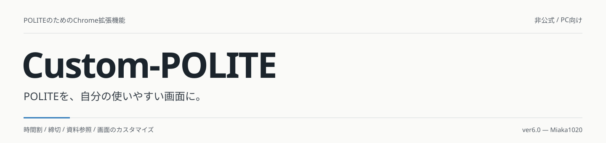
</p>

https://github.com/user-attachments/assets/9225e10a-18f6-47b5-b2c3-b9946ed25812

<p align="center">
  <strong>北海道情報大学のPOLITEを、自分に合った学習画面へ。</strong><br>
  見た目を整える。締切を見つける。資料を横に開く。<br>
  いつものPOLITEに、学習を支える機能を追加するChrome拡張機能です。
</p>

<p align="center">
  <a href="https://chromewebstore.google.com/detail/plihohicbpnimfimobapbjeebebabjja"><strong>Chromeウェブストアで見る</strong></a>
  &nbsp;·&nbsp; <a href="#はじめる">インストール</a>
  &nbsp;·&nbsp; <a href="#機能紹介">機能紹介</a>
  &nbsp;·&nbsp; <a href="#使い方">使い方</a>
</p>

> **非公式の拡張機能です。** 北海道情報大学およびPOLITEの公式サービスではありません。このREADMEは **ver6.0** の機能を紹介しています。ストアの公開版とは、審査・公開時期により内容が異なる場合があります。

## いつもの画面に、必要なものを

<p align="center">
  <a href="assets/readme/hq-overview.png">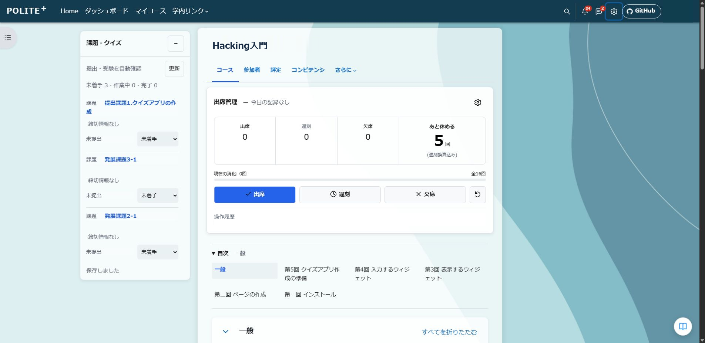</a>
</p>

<p align="center">
  <a href="assets/readme/hq-dashboard-rei.png">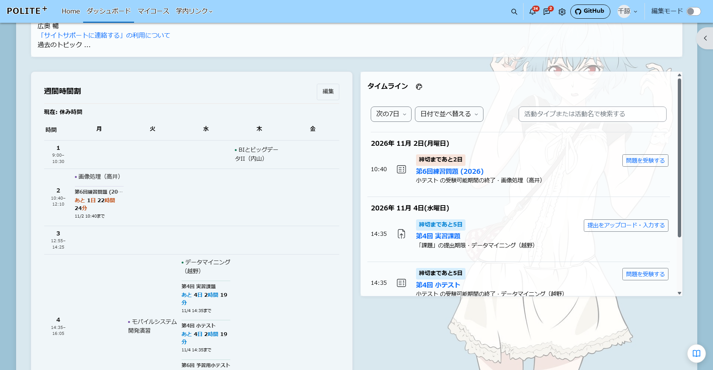</a>
  <br><sub>カスタマイズ例：綾波レイの背景に、ヘッダー・週間時間割・課題の締切を表示。背景画像は利用者が用意したもので、拡張機能には付属しません。</sub>
</p>

画像はクリックすると原寸で開けます。

| やりたいこと | Custom-POLITEでできること |
| --- | --- |
| 学習画面を見やすくしたい | ライト／ダーク、背景画像・動画、透明度、文字、色を調整 |
| 画面の余白を活用したい | PC向けの洗練UIと、ダッシュボード・マイコースの拡張レイアウト |
| 次の授業へすぐ移動したい | 週間時間割からコースへ移動。科目の検索・配置、書き出し・読み込み |
| 締切を見落としたくない | タイムライン掲載時から強調。残り3日・24時間で表示を変更 |
| 課題やクイズの状況を整理したい | コースごとに一覧化。「未着手・作業中」と、Moodleで確認できた提出・受験完了を表示 |
| 出席状況を手元で記録したい | 出席・遅刻・欠席、残りの欠席可能回数、操作履歴を管理 |
| 課題と資料を並べて読みたい | PDF・TXTを右側に表示。コース内のPDFはボタンから追加 |
| 長いコースを移動しやすくしたい | 目次から授業回へ移動。教材の種類をアイコンで見分ける ※洗練UI |
| 自分に合った文字で読みたい | プリセット・カスタムフォントで本文の書体を変更 |
| クイズを復習したい | 対応するレビュー画面で、成績を変更せずに解き直し |

## どこから使う？

最初の設定は**ページ右上の歯車**から。日々の操作は、それぞれの機能の近くに置いています。

| 場所 | 入口 | できること |
| --- | --- | --- |
| ページ右上 | 歯車 | 外観・背景・文字・透明度・レイアウトの設定と保存 |
| ダッシュボード | 週間時間割の「編集」 | 科目を検索して配置、保存、書き出し・読み込み |
| 週間時間割 | 配置した科目名 | 該当するPOLITEのコースへ移動 |
| ダッシュボード | タイムライン見出し横のパレット | 締切の強調色を変更 |
| コース画面 | 「課題・クイズ」一覧 | 課題を開く、作業状況を変更、提出・受験状況を更新 |
| コース画面 | 出席管理の歯車 | 授業回数・必要出席率・遅刻の換算条件を設定 |
| コース画面 | 出席管理の記録ボタン・操作履歴 | 出席・遅刻・欠席を記録、取り消し、履歴の確認 |
| コースの教材一覧 | PDF横の「資料参照に追加」 | PDFを右側に直接表示 |
| 画面右下 | 本のボタン | 資料参照を開く。ファイル選択、URL入力、幅の調整 |
| コース画面 ※洗練UI | 「目次」内の授業回 | 目的の章へ移動。閉じている章は開いて表示 |
| クイズのレビュー画面 | 「解き直し学習モード」 | 開始、回答、採点、リセット、終了 |
| ダッシュボードのアナウンスメント | バージョン・「更新を確認」 | 使い方、現在の版、Chromeウェブストアの更新案内 |
| ページ右上 | GitHub | 開発元のリポジトリを開く |

## 機能紹介

### 背景・ヘッダー・フォントのカスタマイズ

お気に入りの画像や動画を、POLITEの背景に設定できます。背景を楽しみながら学習しやすいように、明度と透明度、本文の透明度をそれぞれ調整できます。

- **画像・動画背景**：手元のファイルを選択して設定。
- **ヘッダーの配色**：背景色・文字色・枠線色を変更。
- **フォント**：プリセットの書体や、フォント名・URLを指定したカスタムフォントを使用。
- **本文の配置**：左寄せ・中央・右寄せから選択。

[背景設定の原寸PNG](assets/readme/hq-background-settings.png) / [ヘッダー配色の原寸PNG](assets/readme/hq-colors.png)

<details>
<summary><strong>フォントの設定画面を見る</strong></summary>

<p align="center">
  <a href="assets/readme/hq-font.png">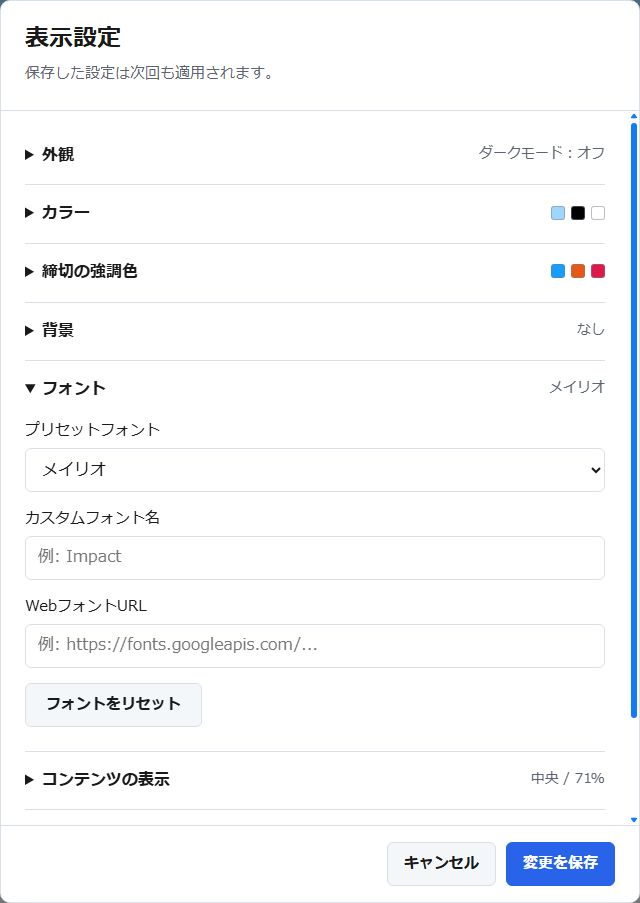</a>
</p>

</details>

### ダークモード

ライト表示から暗い配色へ切り替えられます。「オフ」「常にオン」「自動」を選べるほか、明るさ・コントラスト・グレースケール・セピアも調整できます。設定は次回の表示にも適用されます。

<p align="center">
  <a href="assets/readme/hq-dark.png">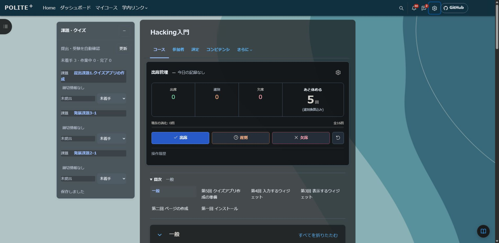</a>
</p>

### 週間時間割

ダッシュボードに、自分の履修科目を並べた週間時間割を表示します。科目名からコースへ移動でき、今日の曜日や授業中のコマも見分けられます。

- **科目の検索・配置**：編集画面で候補を選び、曜日と時限に設定。
- **締切の確認**：科目に関連する課題・クイズの締切も表示。
- **保存と引き継ぎ**：時間割をブラウザに保存。書き出し・読み込みにも対応。
- **表示の切り替え**：時間割が不要な場合は、設定から非表示に変更。

<p align="center">
  <a href="assets/readme/hq-timetable.png">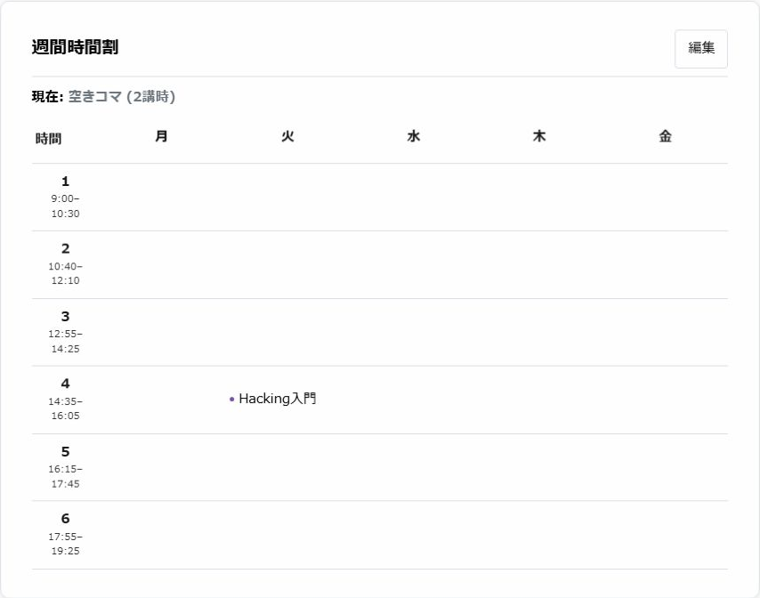</a>
</p>

### 課題の締切を強調

タイムラインに掲載された締切を、残り時間の表示と色で見つけやすくします。掲載時、残り3日以内、24時間以内・期限超過で強調を切り替えます。

強調色はタイムライン見出し横のパレット、または表示設定から変更できます。締切一覧・時間割・課題一覧の配色に反映されます。

<p align="center">
  <a href="assets/readme/hq-deadlines.png">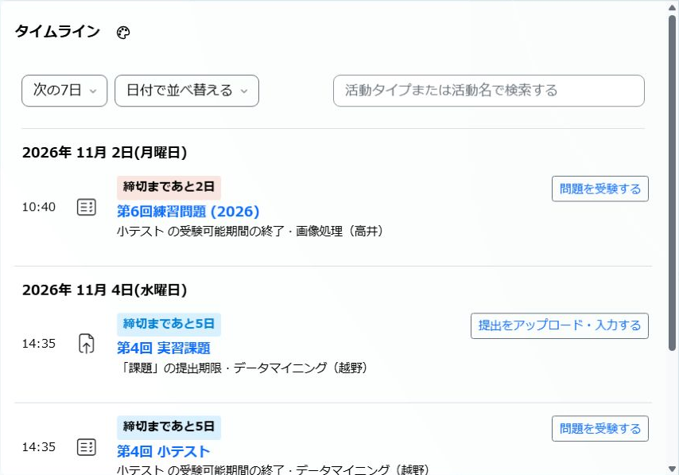</a>
</p>

### 課題・クイズの一覧と自動確認

コース内の課題とクイズを一覧にまとめ、ダッシュボードで取得した締切も表示します。広い画面では左側の余白に置き、本文を読みながら確認できます。

「未着手」「作業中」は自分で管理し、提出済み・受験済みはMoodle上で確認できた結果を反映します。完了した項目は控えめに表示し、これから取り組むものを探しやすくします。

<p align="center">
  <a href="assets/readme/hq-checklist.png">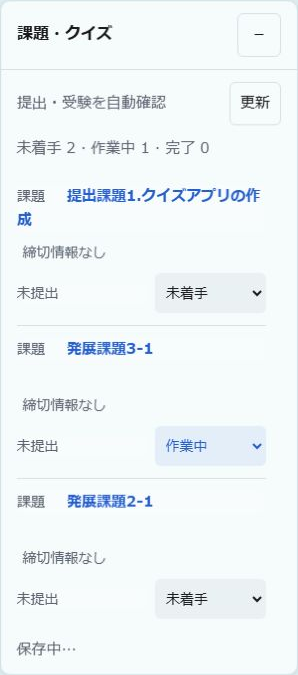</a>
</p>

### 出席管理

コースごとに出席・遅刻・欠席を記録し、あと何回休めるかの目安を表示します。授業回数、必要出席率、遅刻の換算条件はコースごとに設定できます。

操作履歴を残し、直前の記録の取り消しにも対応しています。大学への出席登録とは別の、個人用の管理機能です。

<p align="center">
  <a href="assets/readme/hq-attendance.png">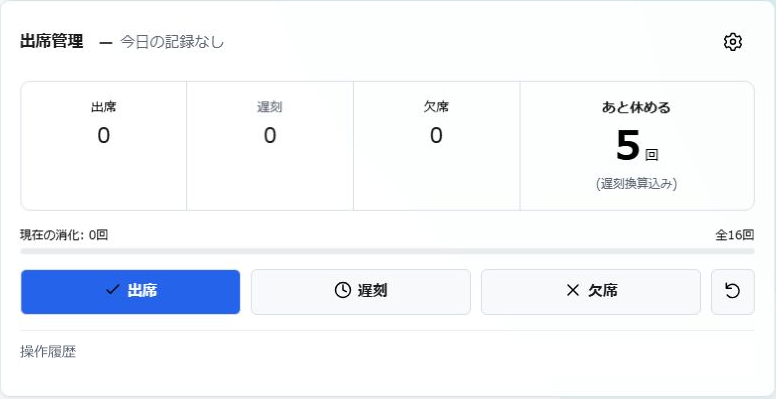</a>
</p>

<details>
<summary><strong>出席管理の歯車から開く設定画面</strong></summary>

<p align="center">
  <a href="assets/readme/hq-attendance-settings.png">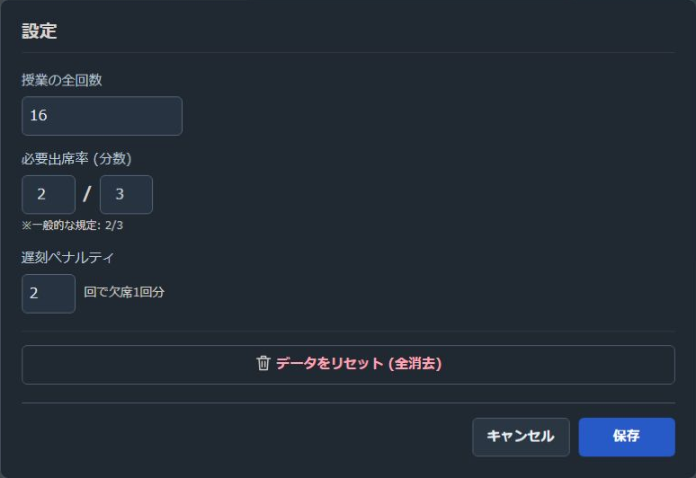</a>
</p>

</details>

### 資料参照サイドバー

PDF・TXTを画面右側に開き、コースや課題と並べて読めます。手元のファイルだけでなく、POLITE内のPDFや資料ページのURLにも対応しています。

コース内のPDFリンク横にある「資料参照に追加」から、そのまま資料を開けます。パネルの幅はドラッグで調整でき、前回開いた資料は次回も復元します。

<p align="center">
  <a href="assets/readme/hq-reference.png">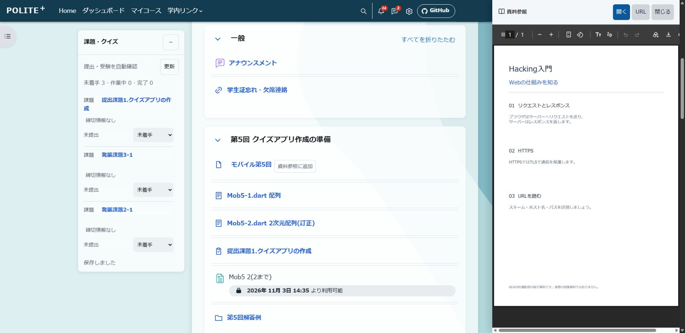</a>
</p>

### クイズの解き直し

対応するクイズのレビュー画面に、復習用の「解き直し学習モード」を追加します。問題を解き直して結果を確認でき、Moodleの成績には影響しません。

問題形式やレビューの公開設定によっては対応できない場合があります。

### 洗練UI・拡張レイアウト・コースの目次

コース上部の余白や操作ボタン、カードの見た目を整える洗練UIを、任意で有効にできます。教材一覧では、PDF・課題・クイズなどを種類別のアイコンで表示します。

拡張レイアウトでは、ダッシュボードとマイコースの表示領域を広げて画面を活用できます。コースの目次から授業回へ移動でき、長いページでも目的の場所を探しやすくなります。

<p align="center">
  <a href="assets/readme/hq-materials.png">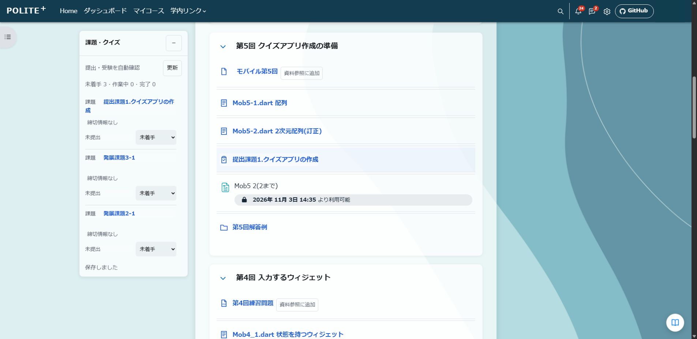</a>
</p>

<details>
<summary><strong>コース上部の目次を原寸で見る</strong></summary>

<p align="center">
  <a href="assets/readme/hq-outline.png">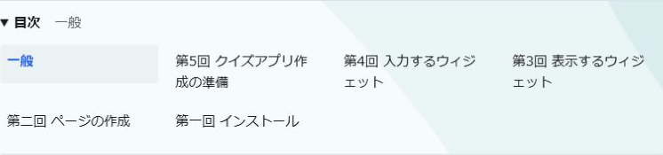</a>
</p>

</details>

### 任意のアニメーション

カードに触れたときの浮き上がり、ボタンの反応、画面の表示や開閉、課題・クイズの完了確認などに短い動きを付けます。設定でオン・オフを選べ、端末の「動きを減らす」設定を優先します。

<p align="center">
  <a href="assets/readme/hq-layout.png">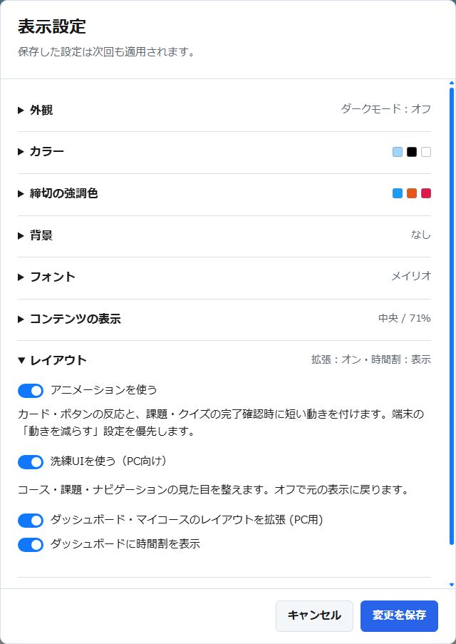</a>
  <br><sub>アニメーションは「表示設定 → レイアウト」から任意で切り替えます。</sub>
</p>

### バージョン表示・更新案内

ダッシュボードのアナウンスメントに、使い方とインストール中のバージョンを表示します。Chromeウェブストア版の更新通知、更新済みの案内、手動の更新確認にも対応しています。

## はじめる

### Chromeウェブストアから

1. [Custom-POLITEのストアページ](https://chromewebstore.google.com/detail/plihohicbpnimfimobapbjeebebabjja)を開き、「Chromeに追加」からインストールします。
2. [POLITE](https://polite.do-johodai.ac.jp/)にログインします。既に開いている場合は、ページを再読み込みしてください。
3. 右上の**歯車**から「表示設定」を開き、好みの表示に調整します。
4. 「**変更を保存**」を押すと、次回も設定が適用されます。

対応対象は **PC版Chrome上のPOLITE** です。ほかのMoodleサイトやスマートフォン向けの機能ではありません。

<details>
<summary><strong>開発版を手動で読み込む</strong></summary>

1. リポジトリの「Code → Download ZIP」からダウンロードし、ZIPを展開します。
2. Chromeで `chrome://extensions/` を開きます。
3. 「デベロッパー モード」をオンにします。
4. 「パッケージ化されていない拡張機能を読み込む」を押します。
5. **`manifest.json` が入っている `dist` フォルダ**を選択します。
6. POLITEを再読み込みします。

手動更新では、同じフォルダの内容を新しい版へ差し替え、拡張機能の再読み込みとPOLITEのページ更新を行います。開発版にChromeウェブストアの自動更新は適用されません。

</details>

## 使い方

### 1. 画面を自分に合わせる

1. ページ**右上の歯車**を押して「表示設定」を開きます。
2. 「外観」「背景」などの見出しを押し、使いたい項目を開きます。閉じた見出しでも現在の設定や色を確認できます。
3. 値を調整し、画面下部の「**変更を保存**」を押します。保存せずに閉じる場合は「キャンセル」です。

<p align="center">
  <a href="assets/readme/hq-header.png">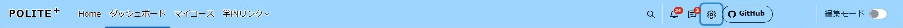</a>
  <br><sub>通知・メッセージの横にある歯車から設定を開きます。</sub>
</p>

<p align="center">
  <a href="assets/readme/hq-settings.png">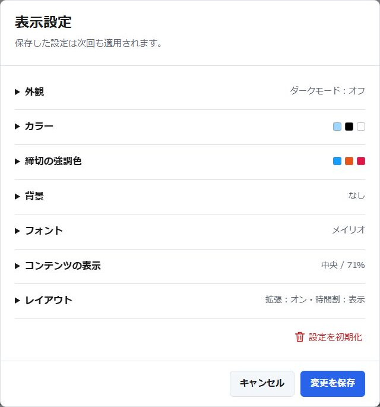</a>
</p>

| 項目 | 設定できること |
| --- | --- |
| 外観 | ダークモードのオフ／常にオン／自動、明るさ・コントラストなど |
| カラー | ヘッダーの背景・文字・枠線の色 |
| 締切の強調色 | 一覧掲載時／3日以内／24時間以内・期限超過の色 |
| 背景 | 手元の画像・動画、背景の透明度と明度 |
| フォント | プリセットやカスタムフォント |
| コンテンツの表示 | 本文の透明度、左・中央・右の配置 |
| レイアウト | 洗練UI、拡張レイアウト、時間割、アニメーションのオン／オフ |

「背景の透明度」と「コンテンツの透明度」は別の設定です。写真やイラストを使う場合は、本文側の透明度も調整すると読みやすくなります。アニメーションは端末の「動きを減らす」設定を優先します。

<details>
<summary><strong>背景・フォント・表示の詳しい設定方法</strong></summary>

- **ダークモード**：「外観 → モード」で「オフ」「常にオン」「システム設定に従う」を選びます。同じグループの明るさ・コントラスト・グレースケール・セピアで調整できます。
- **背景画像・動画**：「背景 → ファイルを選択」から手元のファイルを指定します。種類はファイルから判定されます。背景の透明度と明度を調整し、保存します。
- **本文の透明度・位置**：「コンテンツの表示」でブロックの透明度と、左・中央・右の配置を選びます。
- **ヘッダーの配色**：「カラー」で背景色・文字色・枠線色をそれぞれ指定します。
- **フォント**：「フォント」でプリセットを選択するか、カスタムフォント名・WebフォントURLを入力します。標準の書体へ戻す場合は「Moodle標準」を選び、カスタム指定を空にして保存します。
- **洗練UI・拡張レイアウト**：「レイアウト」で別々にオン・オフを選べます。教材の種類別表示とコースの目次は洗練UI側の機能です。
- **時間割・動き**：「レイアウト」から週間時間割の表示とアニメーションも個別に切り替えられます。
- **初期設定へ戻す**：設定画面の「設定を初期化」を使います。普段の変更を保存せずに戻る場合は「キャンセル」を使ってください。

</details>

### 2. 週間時間割を作る

1. ダッシュボードの週間時間割にある「**編集**」を押します。
2. 曜日・時限に科目名を入力し、候補から科目を選びます。
3. 候補を選ぶと**コースIDが自動入力**されます。曜日・時限を確認して「**保存して適用**」を押します。
4. 週間時間割に戻り、**科目名をクリック**すると、そのコースへ移動します。時間割は授業の入口としても使えます。

<p align="center">
  <a href="assets/readme/hq-timetable-editor.png">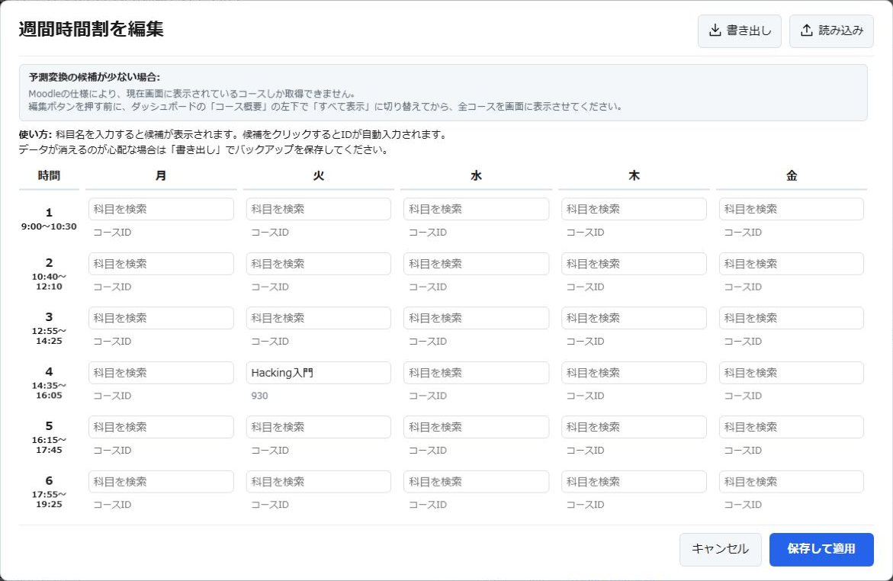</a>
</p>

「**書き出し**」で時間割を保存し、「**読み込み**」で引き継げます。検索候補が少ない場合は、先にダッシュボードの「コース概要」を「すべて表示」に切り替えてください。候補はPOLITE上で取得できたコースに依存します。

### 3. 締切と課題・クイズを確認する

- **ダッシュボード**：タイムラインに掲載された締切を強調します。見出し横のパレットから色を変更できます。
- **コース画面**：課題・クイズを一覧で表示します。画面幅に余裕がある場合は左側に配置されます。
- **作業状況**：「未着手」「作業中」は自分で切り替えられます。
- **完了状況**：Moodle上で確認できた提出・受験の完了を自動反映します。「更新」から再確認できます。

ダッシュボードで取得した締切も、該当コースの一覧へ反映します。自動確認できない場合は、未確認・確認失敗として表示します。最終的な提出状況は、POLITEの課題・クイズ画面でも確認してください。

**締切の色を変える**：タイムライン見出し横のパレットを押し、「一覧に掲載」「3日以内」「24時間以内・期限超過」の3色を選びます。同じ設定は右上の歯車 →「締切の強調色」からも変更できます。締切が一覧に載った段階から強調し、期限が近づくと表示を切り替えます。

**一覧の使い方**：課題名・クイズ名を押すと対象の活動を開きます。選択欄で「未着手／作業中」を変更すると保存します。「提出済み／受験済み」はMoodleで完了が確認できた場合の表示で、自分で完了に書き換える操作ではありません。「更新」で再確認でき、見出しの「−」で一覧を折りたためます。一覧内のスクロールは本文と分かれています。

### 4. 出席を記録する

コースの「出席管理」で「**出席**」「**遅刻**」「**欠席**」を押すと記録できます。取り消しボタンと操作履歴も利用できます。

歯車から授業の全回数、必要出席率、遅刻の換算回数を設定すると、あと何回休めるかの目安を表示します。

たとえば全16回・必要出席率2/3・遅刻2回で欠席1回として計算する場合は、出席管理の歯車を開いてその値を入力し、設定を保存します。ページ右上の表示設定用の歯車とは別です。「操作履歴」は開閉でき、記録を間違えた場合は取り消しボタンを使えます。出席データの初期化も、このコースごとの設定内にあります。

**この記録は個人用です。大学への出席登録・送信は行いません。** 残り回数の表示は入力した条件に基づく計算であり、大学の公式な出席判定ではありません。

### 5. 資料を横に開く

コース内のPDFリンク横にある「**資料参照に追加**」を押すと、右側の資料参照にPDFを開きます。読み込み後はURL入力欄が閉じ、資料を広く表示します。

ほかにも、右下の**本のボタン**から次の方法で開けます。

| 方法 | 操作 |
| --- | --- |
| 手元のPDF・TXT | 「開く」からファイルを選択 |
| POLITEのPDF・資料ページ | 「URL」からURLを入力し、「表示」 |

PDFリンク横の「資料参照に追加」は、**URLの入力 → PDFの読み込み → 入力欄を閉じる**ところまで行います。URLを貼り直したり、「表示」をもう一度押したりする必要はありません。

資料の左端をドラッグすると幅を変更できます。「閉じる」で本文の表示領域に戻り、右下の本のボタンから再び開けます。URL欄は「URL」で開閉します。開閉状態・幅・前回の資料は次回の表示にも使われます。

前回の資料は次回も復元します。PCの広い画面では本文と資料を並べて表示し、境界をドラッグして資料の幅を調整できます。POLITE内のURLにはログインと閲覧権限が必要です。

### 6. クイズを解き直す

対応するクイズのレビュー画面では、「解き直し学習モード」から復習できます。Moodleに保存される成績は変更しません。

1. POLITEで受験済みクイズの**レビュー画面**を開きます。
2. 上部の「**解き直しモードを開始**」を押します。
3. 対応する問題に回答し、「**採点**」で結果を確認します。正誤・得点・解き直しにかかった時間を表示します。
4. 「**リセット**」で再度練習できます。「×」から終了すると、確認後に元のレビュー画面を再読み込みします。

問題形式やレビュー画面の設定によっては、正しく動作しない場合があります。通常の受験・提出の代わりには利用しないでください。

### 7. 長いコースを目次から移動する

右上の歯車 →「レイアウト → 洗練UI」をオンにして保存すると、コース内に目次を表示します。授業回・章の名前を押すと、その場所へ移動します。閉じている章は開いて表示するので、長いページを先頭から探し直す必要がありません。目次そのものも開閉できます。

教材一覧ではPDF、ファイル、課題、クイズ、フォルダ、URL、ページ、ブックを種類に応じたアイコンで見分けられます。教材を開く操作は、通常どおり教材名のリンクから行います。

### 8. 表示を切り替え、更新を確認する

「洗練UI」「拡張レイアウト」「時間割」「アニメーション」は個別の設定です。たとえば、元のコース表示のままダークモードと時間割だけを使うこともできます。拡張レイアウトはダッシュボードとマイコースの表示幅・カード配置を調整します。

ダッシュボードのアナウンスメントには「Custom-POLITEの使い方」と現在のバージョンがあります。「更新を確認」からChromeウェブストア版の更新状況を確認できます。更新案内が出た場合の操作は、次の「更新について」を参照してください。

<details>
<summary><strong>細かな表示改善も含めた機能一覧</strong></summary>

| 分類 | ver6.0で利用できる機能 |
| --- | --- |
| 外観 | ダークモードのオフ／常時／システム連動、明るさ、コントラスト、グレースケール、セピア |
| 背景 | 画像・動画ファイル、背景の明度・透明度、次回表示時の復元 |
| 文字と配置 | プリセット・カスタムフォント、WebフォントURL、本文の配置、コンテンツの透明度 |
| ヘッダー | 背景・文字・枠線の色、GitHubへのリンク、POLITE+の表示 |
| 設定 | 項目の開閉、見出しで現在値・色を確認、保存・キャンセル・初期化 |
| ページの表示 | 保存した外観を初期表示へ適用、専用ローディング画面なしのダーク表示 |
| レイアウト | 任意の洗練UI、ダッシュボード・マイコースの拡張、コース上部の省スペース化 |
| 時間割 | 週間表示、曜日・時限、現在の授業、科目からコースへ移動、関連する締切の表示 |
| 時間割編集 | 科目名検索、候補選択とID自動入力、保存、JSONの書き出し・読み込み、表示のオン／オフ |
| 締切 | タイムライン掲載時からの強調、残り時間、3日・24時間の強調、3段階の色設定 |
| 課題・クイズ | コース内の一覧と活動へのリンク、件数表示、手動の作業状態保存、提出・受験の自動確認、再確認、確認失敗の表示 |
| 課題一覧の表示 | ダッシュボードで取得した締切の反映、完了項目を控えめに表示、開閉、独立したスクロール |
| 出席 | コース別の出席・遅刻・欠席、残り回数、授業回数・出席率・遅刻換算、履歴、取り消し、初期化 |
| 資料参照 | PDF・TXTファイル、POLITEのPDF／資料ページURL、PDF横からの追加と自動表示、URL欄の開閉、パネル幅の変更、資料と開閉状態の復元 |
| 復習 | クイズレビューからの解き直し開始、採点、正誤・得点・所要時間、リセット、終了 |
| コース移動 | 授業回の目次、現在位置の表示、移動先の章を展開、教材の種類別アイコン ※洗練UI |
| 操作の見やすさ | ボタン付近の操作結果、表の数値の桁位置、アイコンと操作ボタンの見た目の統一 |
| 動き | カード・ボタン・表示・開閉・完了確認時のアニメーション、個別オン／オフ、端末の動きを減らす設定を優先 |
| 案内・更新 | ダッシュボードの機能説明、ver表示、Chromeウェブストアの更新通知、更新後の案内、手動確認 |

削除済みのアーカイブ機能とプレビュー機能は含みません。提出・受験・出席の大学側の記録を、この一覧の状態変更や個人用出席ボタンで代行する機能はありません。

</details>

## 更新について

ストア版はChromeの自動更新の対象です。ダッシュボードのアナウンスメント内に、インストール中のバージョンと更新情報を表示します。

- **更新が届いているとき**：新しい版を赤字で案内します。
- **更新後**：バージョンが上がったことを検知すると、更新済みの案内を表示します。
- **手動で確認したいとき**：「更新を確認」からChromeに問い合わせます。

更新確認の対象は **Chromeウェブストア版**です。開発版で読み込んでいる場合は、その旨を表示します。配信には時間差があるほか、短時間の連続確認はChrome側で制限されることがあります。更新後はPOLITEも再読み込みしてください。

## データの保存について

設定・時間割・出席記録・課題の作業状況はChromeのローカルストレージ、背景ファイルや参照資料はブラウザ内のIndexedDBへ保存します。この拡張機能独自のクラウド同期はありません。

課題・クイズの完了確認や資料の読み込みには、ログイン中のPOLITEへの通信を使用します。対象サイトは `https://polite.do-johodai.ac.jp/*` です。宣言している権限は [`public/manifest.json`](public/manifest.json) で確認できます。

背景と参照資料は、ブラウザや端末を変えただけでは引き継がれません。時間割は書き出してバックアップできます。ブラウザデータを削除する場合は、保存した情報が失われることがあります。

## 開発する

```bash
npm ci
npm run build
```

Node.jsとnpmを用意し、ビルド後の `dist` をChromeへ読み込みます。

| ディレクトリ | 内容 |
| --- | --- |
| `src/` | コンテンツスクリプトと機能ごとの実装 |
| `public/` | Manifest、スタイル、更新検知のService Workerなど |
| `dist/` | Chromeへ読み込むビルド成果物 |
| `assets/readme/` | 機能紹介の画像・表紙・紹介動画 |

## 変更履歴

### ver6.0

- 任意で切り替えられる洗練UI、拡張レイアウト、アニメーションを整備。
- コースの課題・クイズ一覧、提出・受験状況の自動確認、目次を追加。
- 締切の強調と色設定、時間割・出席管理・表示設定のUIを改善。
- PDFリンクから資料参照への追加と自動表示、本文との横並びに対応。
- ダークモードの初期適用と、表示の切り替えを改善。
- ダッシュボードに使い方・バージョン情報・Chromeウェブストアの更新案内を追加。

<details>
<summary><strong>以前の変更履歴</strong></summary>

| バージョン | 主な変更 |
| --- | --- |
| v5.0 | 出席管理、履歴と取り消し、欠席回数に基づく表示、設定画面の改善 |
| v4.4 | 時間割UIを修正 |
| v4.3 | ダークモードの不具合を修正 |
| v4.2 | 時間割UIを修正 |
| v4.1 | カスタム設定をクリックできない不具合を修正 |
| v4.0 | ダークモード、時間割の保存、コースID取得、拡張レイアウトなどを追加 |
| v3.0 | フォント変更を追加 |
| v2.1 | 時間割への締切表示、狭い画面でのヘッダーと透明度を調整 |
| v2.0 | 解き直しモードを追加 |
| v1.0 | 初回リリース |

</details>

## 不具合報告・お問い合わせ

[GitHub Issues](https://github.com/Miaka1020/Moodle-Custom-Extension/issues) または [メール](mailto:lqianye03@gmail.com)で受け付けています。

使用中のバージョン、発生した画面、操作手順があると確認しやすくなります。画像を添付する場合は、氏名・学籍番号・メッセージ・成績などが写っていないか確認してください。

開発者：**[Miaka1020](https://github.com/Miaka1020)**

紹介動画のBGM：[ぽっぷすたー／猫きまぐれBGM工房](https://kim4gure.com/popstar/)

## ライセンス・利用上の注意

Copyright (c) 2025 Miaka1020. All Rights Reserved.

本拡張機能のソースコードやデザインの改変、および二次配布（再配布）は固く禁止します。

本拡張機能は非公式に開発されたもので、北海道情報大学とは関係ありません。利用により発生した不具合・損害について、開発者は責任を負いません。POLITEや授業での提出・出席・成績の確認は、大学の公式な画面・案内を優先してください。
